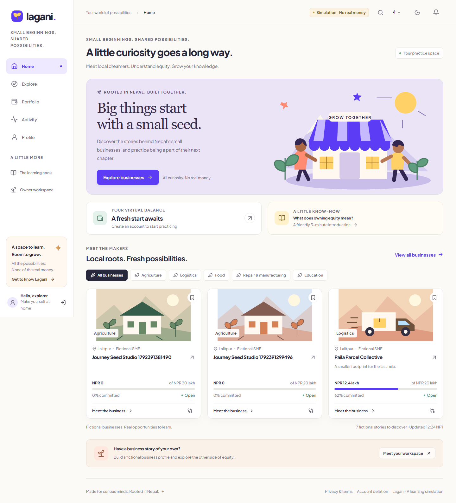
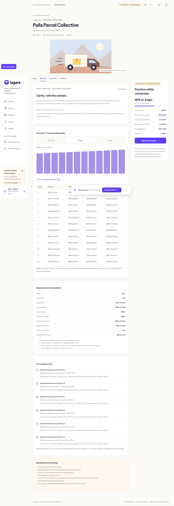
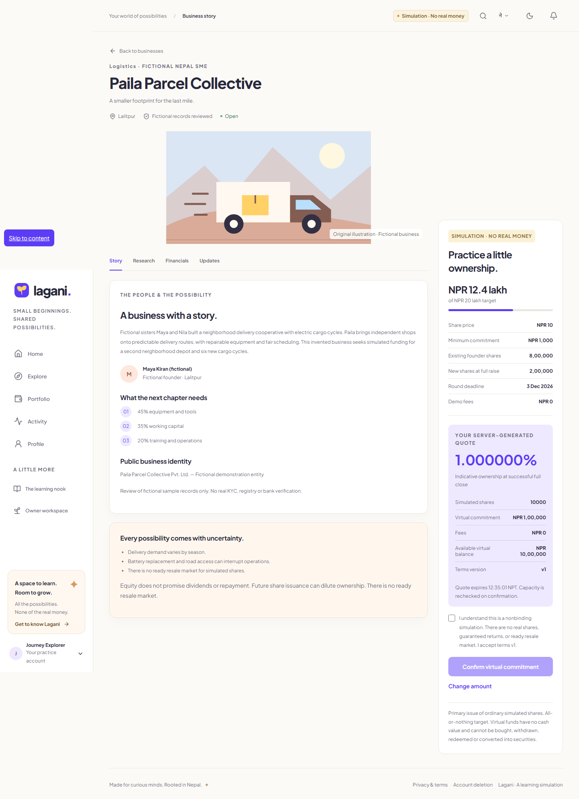
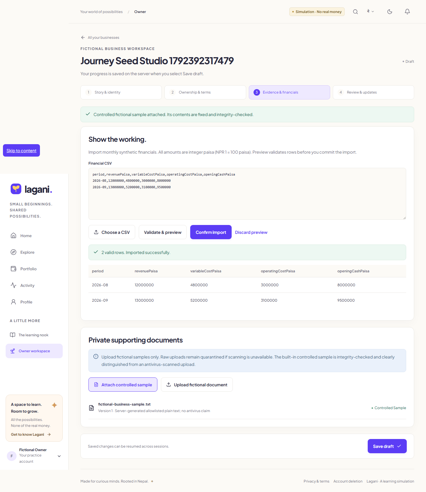
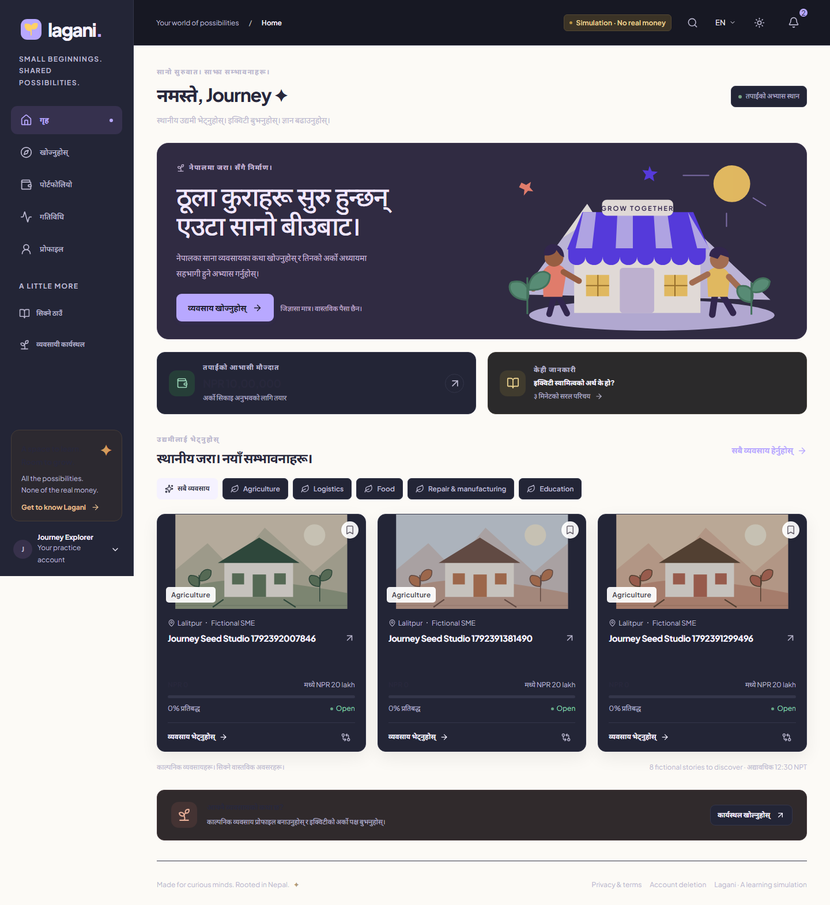

<p align="center"></p>
<h1 align="center">Lagani</h1>
<p align="center"><strong>Small beginnings. Shared possibilities.</strong><br/>A Nepal-focused equity crowdfunding learning simulation.</p>
<p align="center">Flutter · React · NestJS · PostgreSQL · English / नेपाली</p>

> **Simulation · No real money.** Virtual funds cannot be bought, withdrawn, redeemed or converted to securities. Businesses, evidence and ownership are fictional. This is a local simulation implementation, not a Play-approved or live investing release.



## What you can explore

- Investor discovery, sector/location search, saved businesses, comparison, reviewed research and 12-month conditional scenarios.
- Server-generated equity quotes, deliberate risk acknowledgment, persisted commitments, cancellation, refunds, cost-based portfolio and nonbinding receipts.
- An owner workspace for fictional business drafts, exact financial CSV preview/import, private sample documents and submission timelines.
- A reviewer queue, explicit fictional checks, report preparation, separate admin publication, owner-update moderation and round closure.
- An append-only double-entry virtual ledger, PostgreSQL locks, caller-scoped idempotency, durable notifications and reconciliation.
- Light/dark themes, English/Nepali settings, reduced motion, learning, profile export and verified account deletion.

The Flutter app opens in the investor experience. The responsive browser companion also makes owner and review journeys accessible on a desktop. See [test evidence and remaining limitations](docs/TEST-RESULTS.md) for what actually ran and what still needs work.

## Run locally

Use Node **24.13.1**, npm **11.8.0**, and PostgreSQL **18.4**. Dependencies are resolved in committed lock files. No paid services are required for fixture analysis.

```bash
npm ci
npm run setup
```

Start the database with either Docker:

```bash
docker compose up -d postgres
```

Or the bundled native Windows alternative:

```bash
npm run db:start
```

Then migrate, seed and launch:

```bash
npm run db:migrate
npm run db:seed
npm run dev
```

Open **[localhost:5173](http://127.0.0.1:5173)**. API health: **[localhost:4000/api/health](http://127.0.0.1:4000/api/health)**. API docs: **[localhost:4000/api/docs](http://127.0.0.1:4000/api/docs)**. The public local privacy and deletion pages are `/privacy` and `/delete-account`.

The default database credentials are exclusively for the loopback local demo. Custom connection/provider settings belong in `services/api/.env`; start with its secret-free `.env.example`. Do not expose local auth, the development mailbox or the database to the internet.

### Demo accounts

Seeding generates a random password into **`services/api/.local/demo-accounts.json`**, which is ignored by Git. It provisions `investor@lagani.local`, `owner@lagani.local`, `reviewer@lagani.local` and `admin@lagani.local` for separate roles. No universal admin password is committed. Alternatively create an investor account in the app, read its local development verification message, verify the token, and complete the adult simulation profile.

See the [demo walkthrough](docs/WALKTHROUGH.md). The seed is idempotent; it never silently resets financial history.

### Flutter

```bash
cd apps/mobile
flutter pub get --enforce-lockfile
flutter run --dart-define=API_URL=http://10.0.2.2:4000/api
```

See [mobile setup and verification](apps/mobile/README.md) for the actual SDK pin, platform connectivity and build status. An Android emulator uses `10.0.2.2` to reach the host. Local auth is intentionally loopback restricted; `adb reverse tcp:4000 tcp:4000` with a loopback API URL is another development option. Release configuration must use HTTPS and configured hosted identity.

## Verify

```bash
npm run typecheck
npm run build
npm test
npm run test:integration
npm run test:contrast
npx playwright install chromium
npm run test:e2e
```

Integration tests create and remove an isolated PostgreSQL test database. Browser tests use a running local stack, persist fictional test records and capture actual rendered screens. They do not mock away the API or database. Check [TEST-RESULTS.md](docs/TEST-RESULTS.md) for actual counts, commands and blockers; CI configuration alone is not a passed CI run.

## A closer look

| Reviewed evidence | A deliberate virtual commitment |
| --- | --- |
|  |  |

| Owner evidence workspace | Dark theme and Nepali discovery |
| --- | --- |
|  |  |

## Source map

```text
apps/mobile/             Flutter investor application
apps/admin/              React investor, owner and reviewer companion
services/api/            NestJS API, financial model and worker
supabase/migrations/     Private application schema; SQL migration owner
packages/contracts/     API reference
packages/design-tokens/  Shared brand, color and motion reference
tests/e2e/               Actual browser journeys
docs/                    Evidence, screenshots and release handoff
```

[Architecture](docs/ARCHITECTURE.md) · [API contract](packages/contracts/api.md) · [Design](docs/DESIGN.md) · [Privacy/disclosures](docs/PRIVACY-AND-DISCLOSURES.md) · [Implementation checklist](docs/IMPLEMENTATION.md) · [Future live-investing gaps](docs/FUTURE-LIVE-GAPS.md)

## Boundaries that matter

Fixture reports use explicitly fictional evidence; they do not claim live research or a probability of success. External AI, Supabase hosting, private storage and push credentials are not provisioned by this repository. Raw uploads fail closed if ClamAV is unavailable; the built-in generated sample is clearly marked separately. A real-money product would require a separate legal, custody, payments, security and operational implementation.

Original code and code-native illustrations are MIT licensed. Bundled fonts retain their upstream OFL licenses; see [asset notices](docs/ASSETS.md).
